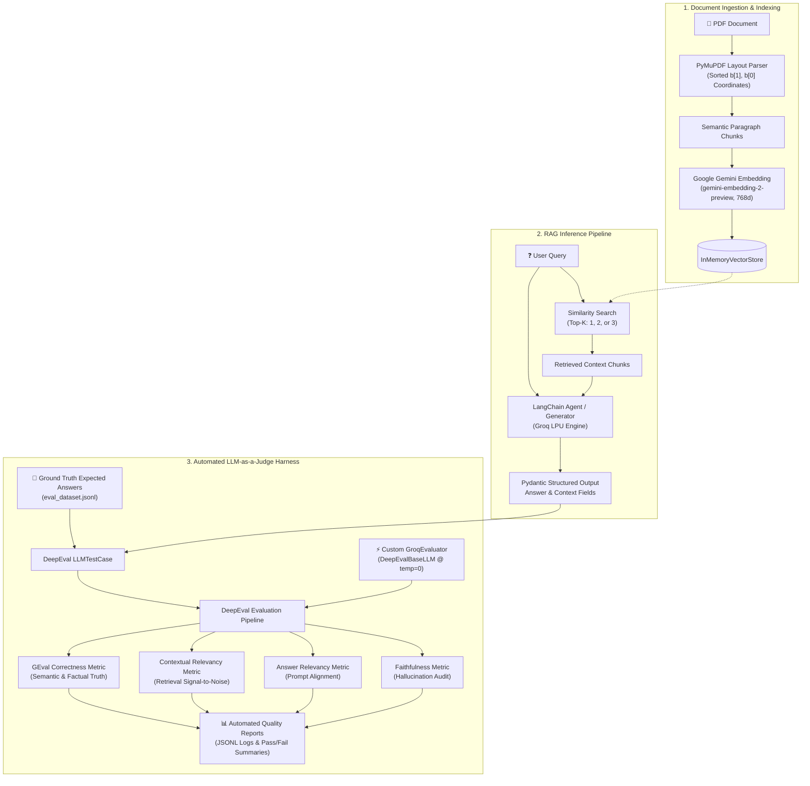

<div align="center">

# 📊 Production-Grade RAG Evaluation System with DeepEval

### *Automated LLM-as-a-Judge Benchmarking, Hallucination Auditing & Retrieval Ablation Pipeline*

[](https://www.python.org/)
[](https://python.langchain.com/)
[](https://confident-ai.com/)
[](https://groq.com/)
[](https://ai.google.dev/)
[](LICENSE)

<br/>

**A systematic LLMOps evaluation framework engineered to eliminate "vibes-based" testing in Retrieval-Augmented Generation (RAG).**  
Powered by **DeepEval**, **Groq LLM-as-a-Judge**, **LangChain**, and **Google Gemini Embeddings**, this system quantifies the complete **RAG Triad** (Faithfulness, Answer Relevancy, Contextual Relevancy) alongside **GEval Semantic Correctness**, conducting controlled ablation studies across retrieval hyperparameter configurations.

[Key Highlights](#-key-engineering-highlights) •
[Architecture](#-system-architecture) •
[Benchmark Results](#-ablation-study--empirical-benchmarks) •
[Evaluation Metrics](#-evaluation-framework-the-rag-triad--geval) •
[Quickstart](#-quickstart--reproduction) •
[Competency Matrix](#-recruiter-summary--core-competencies)

---

</div>

## 🎯 Executive Summary & Problem Statement

Building a functional RAG proof-of-concept is straightforward; **deploying a reliable, non-hallucinating RAG pipeline in production is not.** In production environments:
* Increasing retrieved chunks ($k$) frequently injects noise, degrading context relevancy and inflating token costs.
* Manual spot-checking fails to scale, masking regressions and factual drift across pipeline iterations.
* Evaluating with frontier models via standard APIs introduces prohibitive latency and cloud spend.

**Solution:** This repository provides an automated, end-to-end evaluation harness featuring:
1. **High-Throughput LLM-as-a-Judge**: A custom `GroqEvaluator` implementation integrating sub-second Groq inference into DeepEval for cost-effective, deterministic evaluations at scale.
2. **Empirical Top-K Ablation ($k=1, 2, 3$)**: Controlled evaluation over 20 structured test cases to analyze the exact tipping point where additional context harms signal-to-noise ratio.
3. **Deterministic Contract Enforcing**: Pydantic schema validation (`Answer`) via Function Calling, preventing output drift and guaranteeing unambiguous context attribution.

---

## 🔬 System Architecture



---

## 🏆 Key Engineering Highlights

### 1. Custom DeepEval LLM-as-a-Judge Provider (`groq_evaluator.py`)
- Standard LLM-as-a-judge pipelines using GPT-4 are slow and cost-prohibitive for CI/CD batch runs.
- Engineered `GroqEvaluator` by subclassing `DeepEvalBaseLLM`, exposing synchronous `generate()` and asynchronous `a_generate()` interfaces over Groq's low-latency LPUs at `temperature=0`.
- Enabled near-instant evaluation across all 4 metrics without paying high API premiums.

### 2. Geometry-Aware Semantic PDF Ingestion (`RAG1/file_reader.py`)
- Avoids naive character-count chunking that splits sentences or corrupts tables.
- Leverages `PyMuPDF` (`fitz`) bounding block coordinates sorted by vertical and horizontal order (`b[1], b[0]`), preserving document reading flow and extracting clean paragraph-level chunks.

### 3. Strict Function Calling / Structured Output (`RAG1/agent.py`)
- Forces the generation model to return a validated Pydantic object containing two distinct string fields:
  ```python
  class Answer(BaseModel):
      answer: str = Field(description="Answer based ONLY on retrieved PDF context")
      context: str = Field(description="Retrieved PDF context used to answer")
  ```
- Prevents context leakage and allows automated matching between the actual context retrieved by the vector store and the context evaluated by DeepEval.

---

## 📊 Ablation Study & Empirical Benchmarks

An empirical study was conducted across three distinct retrieval configurations ($k=1, k=2, k=3$) over a curated benchmark dataset of 20 domain-specific questions (`eval_dataset.jsonl`) evaluated against strict thresholds (`threshold = 0.70`).

### 📈 Comparative Results Table

| Pipeline Version | Top-$k$ Chunks | Answer Relevancy | Faithfulness (Anti-Hallucination) | Contextual Relevancy | Factual Correctness (GEval) | Context Relevancy Pass Rate | Overall Verdict |
| :--- | :---: | :---: | :---: | :---: | :---: | :---: | :---: |
| **Version 1 (V1)** | **$k = 1$** | **1.00** (100%) | **1.00** (100%) | **0.78** (60%) | **0.91** (95%) | 12 / 20 Passed | 🟢 **Optimal Balance** |
| **Version 2 (V2)** | **$k = 2$** | **1.00** (100%) | **1.00** (100%) | **0.79** (60%) | **0.89** (95%) | 12 / 20 Passed | 🟡 Good Recall |
| **Version 3 (V3)** | **$k = 3$** | **0.99** (100%) | **1.00** (100%) | **0.73** (50%) | **0.90** (95%) | 10 / 20 Passed | 🔴 **Context Dilution** |

### 🔍 Quantitative Takeaways & Production Insights:
1. **Zero Hallucinations Achieved**: Across all three versions, **Faithfulness scored 1.00 (100% pass rate)**. The strict system prompt constraints combined with Pydantic structured output completely prevented ungrounded hallucination.
2. **The "Top-K Context Dilution" Phenonemon**:
   - While increasing $k$ from 1 to 3 preserved Answer Relevancy and Faithfulness, **Context Relevancy pass rate dropped from 60% down to 50%**, with average score falling from **0.79 to 0.73**.
   - Retrieving 3 chunks introduced tangential text that diluted prompt signal without producing any statistically significant gain in Correctness (91% at $k=1$ vs 90% at $k=3$).
3. **Engineering Decision**: **$k=1$ or $k=2$ represents the Pareto-optimal configuration**, minimizing context token usage, reducing inference latency, and maintaining maximum retrieval precision.

---

## 📐 Evaluation Framework: The RAG Triad + GEval

```
                 ┌─────────────────────────────────┐
                 │           User Query            │
                 └──────┬───────────────────▲──────┘
                        │                   │
             Contextual │                   │ Answer
              Relevancy │                   │ Relevancy
                        ▼                   │
                 ┌─────────────┐     ┌──────┴──────┐
                 │  Retrieved  ├────►│  Generated  │
                 │   Context   │     │   Answer    │
                 └─────────────┘     └─────────────┘
                        ▲                   │
                        └───────────────────┘
                             Faithfulness
                       (Zero-Hallucination Metric)
```

1. **Faithfulness (`FaithfulnessMetric`, threshold: 0.7)**:
   Measures factual alignment between the generated output and the retrieved context. Detects hallucinations, fabricated claims, or assumptions not present in source documents.
2. **Answer Relevancy (`AnswerRelevancyMetric`, threshold: 0.7)**:
   Measures whether the generated answer directly answers the user prompt without being incomplete, evasive, or digressive.
3. **Contextual Relevancy (`ContextualRelevancyMetric`, threshold: 0.7)**:
   Measures the signal-to-noise ratio of the vector retrieval stage. Penalizes chunks that do not contain information pertinent to the query.
4. **GEval Correctness (`GEval`, threshold: 0.7)**:
   A tailored LLM-as-a-judge rubric that validates semantic and factual consistency against ground-truth answers, accepting stylistic paraphrasing while penalizing omissions or factual contradictions.

---

## 📂 Repository Structure

```text
├── groq_evaluator.py            # Custom DeepEvalBaseLLM implementation leveraging ChatGroq LPUs
├── eval_dataset.jsonl           # Curated golden benchmark dataset (20 QA test cases with ground truth)
│
├── RAG1/                        # Core RAG Application Architecture
│   ├── agent.py                 # Structured generation agent using LangChain & Pydantic function calling
│   ├── indexing.py              # Google Gemini 768d vector embeddings & vector store initialization
│   ├── file_reader.py           # Coordinate-sorted PDF paragraph extractor (PyMuPDF)
│   ├── tools.py                 # Tool interface for similarity search retrieval
│   ├── prompts.py               # Grounded system prompt & strict anti-hallucination guardrails
│   └── objects.py               # Pydantic schemas (Answer, Context)
│
├── single_tests/                # Granular, single-metric test cases for isolated debugging
│   ├── eval_answer_relevancy.py # Answer relevancy evaluation test
│   ├── eval_context_relevancy.py# Retrieval context relevancy test
│   ├── eval_correctness.py      # GEval factual correctness test
│   └── eval_faithfulness.py     # Faithfulness / hallucination test
│
├── version/                     # Top-K Retrieval Ablation Experiments
│   ├── v1/                      # Experiment 1: Top-K = 1
│   │   ├── eval_runner1.py      # Batch inference runner
│   │   ├── eval_all_metrics1.py # DeepEval test harness (all 4 metrics)
│   │   ├── results1.jsonl       # Raw generation logs
│   │   ├── final_results1.jsonl # Complete metrics & scores
│   │   └── evaluation_summary_v1.py # Executive metrics summary aggregator
│   ├── v2/                      # Experiment 2: Top-K = 2
│   └── v3/                      # Experiment 3: Top-K = 3
│
├── pdfs/                        # Source PDF documentation
├── .env.example                 # Template for required environment variables
└── README.md                    # Project documentation & benchmark analysis
```

---

## 🚀 Quickstart & Reproduction

### 1. Prerequisites & Installation

Clone the repository and install dependencies:
```bash
git clone https://github.com/iftiarrafi/Rag-Evaluation-System-with-Deepeval.git
cd Rag-Evaluation-System-with-Deepeval
pip install -r requirements.txt
```
*(Dependencies: `deepeval`, `langchain`, `langchain-groq`, `langchain-google-genai`, `pymupdf`, `pydantic`, `python-dotenv`)*

### 2. Configure API Credentials

Create a `.env` file from `.env.example`:
```bash
cp .env.example .env
```
Provide your API keys:
```env
GROQ_API_KEY="your-groq-api-key"
GOOGLE_API_KEY="your-google-api-key"
```

### 3. Run a Standalone Metric Test

Verify the LLM-as-a-judge setup on a single test case:
```bash
# Test Faithfulness / Hallucination Detection
python single_tests/eval_faithfulness.py

# Test Contextual Relevancy
python single_tests/eval_context_relevancy.py
```

### 4. Run Full Batch Evaluation Across Versions

Generate answers and evaluate all 4 metrics across the golden dataset:
```bash
# 1. Run inference for version 1 (Top-k = 1)
python version/v1/eval_runner1.py

# 2. Execute DeepEval 4-metric evaluation harness
python version/v1/eval_all_metrics1.py

# 3. Print the executive statistical summary
python version/v1/evaluation_summary_v1.py
```

---

## 💼 Recruiter Summary & Core Competencies

This project demonstrates practical expertise across high-demand AI / LLMOps competencies:

| Competency | Demonstrated In |
| :--- | :--- |
| **LLMOps & Evaluation Frameworks** | End-to-end integration of **DeepEval**, designing custom evaluation metrics with `GEval`, and establishing quantifiable pass/fail thresholds. |
| **LLM-as-a-Judge Design** | Custom `DeepEvalBaseLLM` extension with Groq LPUs, implementing deterministic judge temperature and cost-effective batch scoring. |
| **RAG Engineering & Architecture** | Layout-aware semantic chunking with PyMuPDF, vector embedding pipelines with Google Gemini (`768d`), and similarity retrieval. |
| **Hallucination Mitigation** | Achieving **100% Faithfulness** through prompt constraints and Pydantic function calling schemas. |
| **Ablation & Hyperparameter Tuning** | Empirical benchmarking of retrieval Top-K ($k=1, 2, 3$), identifying context degradation and token inefficiency. |
| **Code Modularity & Clean Architecture** | Decoupled indexing, retrieval, execution, evaluation, and test suites. |

---

## 👤 Author & Contact

**Iftiar Rafi**  
*Machine Learning / LLM Engineer*  

- **GitHub:** [@iftiarrafi](https://github.com/iftiarrafi)  
- **Repository:** [Rag-Evaluation-System-with-Deepeval](https://github.com/iftiarrafi/Rag-Evaluation-System-with-Deepeval)  
- **Open to:** Machine Learning Engineer, Generative AI / LLMOps Engineer roles.
